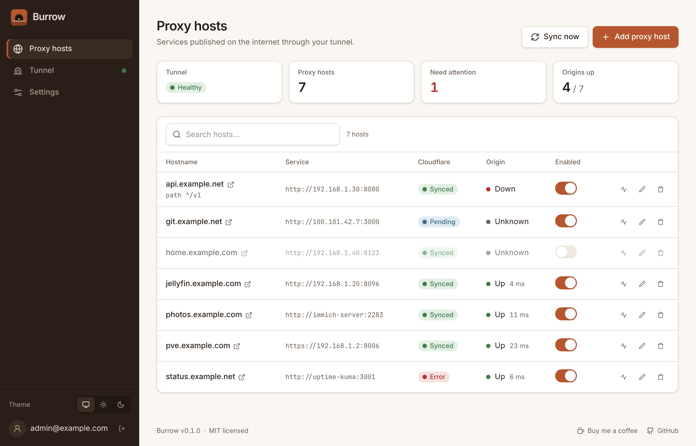
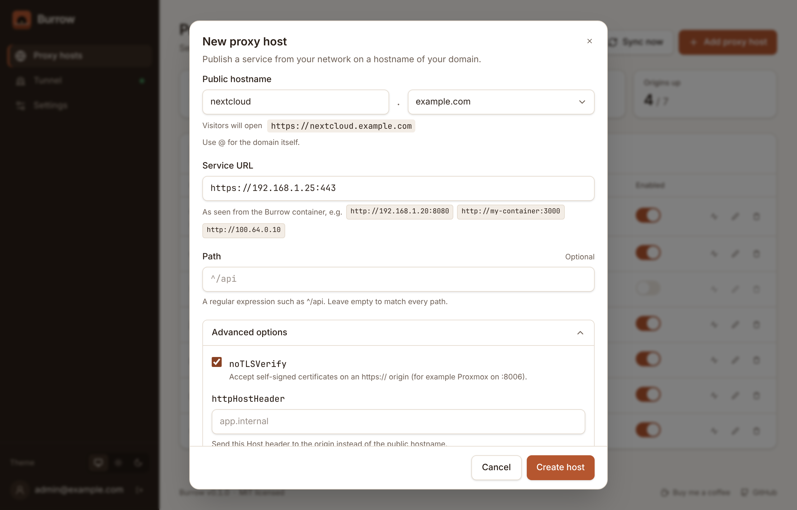
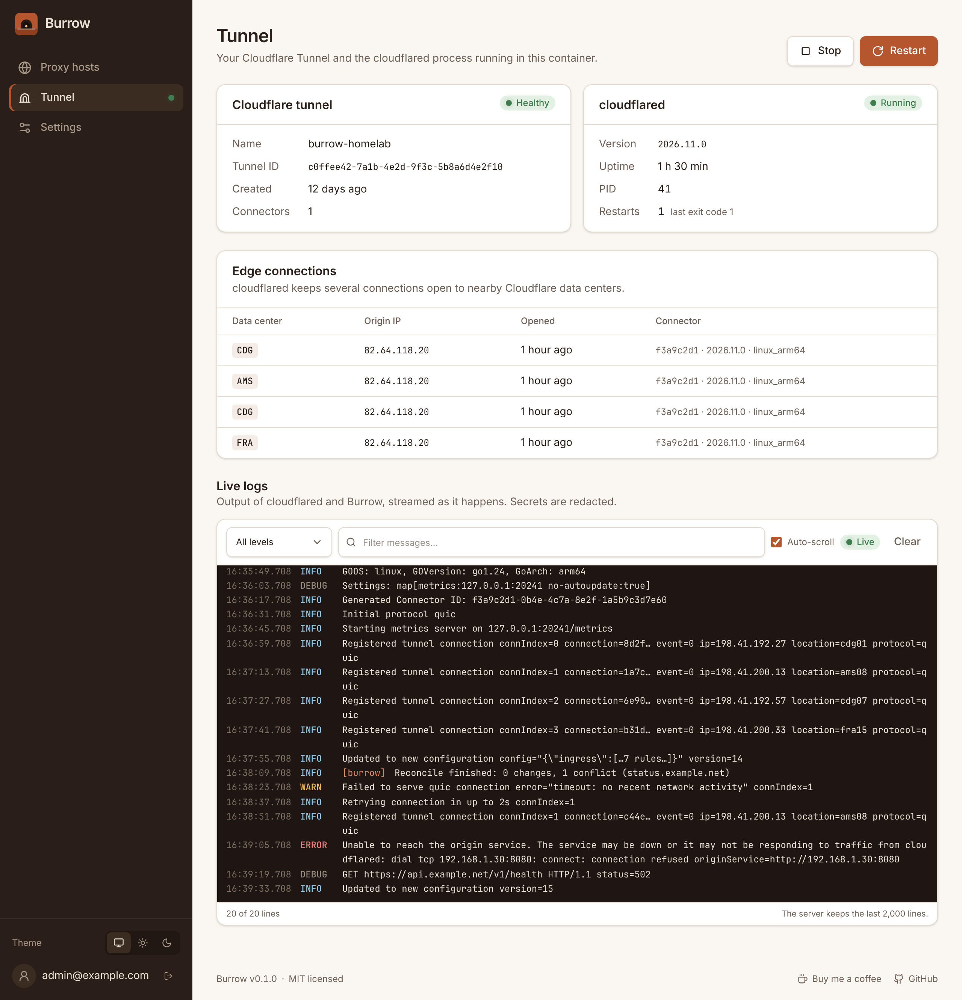

<p align="center">
  
</p>

<h1 align="center">Burrow</h1>

<p align="center">
  <strong>Publish your homelab services through Cloudflare Tunnel, from a simple web UI.</strong><br>
  Like Nginx Proxy Manager, but for Cloudflare Tunnel. No YAML, no Zero Trust dashboard, no open ports.
</p>

<p align="center">
  <a href="https://github.com/noamroger/burrow/actions/workflows/ci.yml"></a>
  <a href="https://github.com/noamroger/burrow/pkgs/container/burrow"></a>
  <a href="LICENSE"></a>
  <a href="https://buymeacoffee.com/noamroger"></a>
</p>

---

## What is Burrow?

[Cloudflare Tunnel](https://developers.cloudflare.com/cloudflare-one/connectors/cloudflare-tunnel/)
lets you put a service on the internet **without opening any port** on your
router: a small program, `cloudflared`, opens an outbound connection to
Cloudflare, and Cloudflare sends your visitors through it.

Setting it up by hand means creating a tunnel, writing ingress rules and
adding DNS records for every service. **Burrow does all of that for you.**

You run **one Docker container**. You open the web UI. For each service, you
type a name (`photos.example.com`) and an internal address
(`http://192.168.1.20:2342`). Burrow then:

1. adds the route to your tunnel,
2. creates the DNS record on Cloudflare,
3. keeps `cloudflared` running and shows you its logs,
4. checks that your service answers.

When you remove the service, Burrow removes the route and the DNS record.

## Features

- **One image, everything inside**: web UI, API, the official `cloudflared`
  binary and a SQLite database. Multi-arch (amd64 and arm64, so it runs on a
  Raspberry Pi).
- **Proxy hosts in a few clicks**: subdomain, domain, internal URL. Optional
  path, `noTLSVerify`, `httpHostHeader` and `originServerName` settings.
- **DNS handled for you**: Burrow creates the `CNAME` records and only ever
  touches records it created itself.
- **cloudflared supervision**: automatic start, restart with backoff, live
  logs in the browser.
- **Health at a glance**: tunnel status, connected Cloudflare data centers,
  and a reachability check for every service.
- **Self-healing sync**: if something changes on Cloudflare, Burrow notices
  and puts things back the way you configured them.
- **Secure by default**: argon2id passwords, encrypted API token, CSRF
  protection, login rate limiting, non-root container.

## Screenshots

| Proxy hosts                                     | Add a host                                    |
| ----------------------------------------------- | --------------------------------------------- |
|  |  |

| Tunnel and live logs                                        | First-run setup                                  |
| ----------------------------------------------------------- | ------------------------------------------------ |
|  |  |

## Quick start (2 minutes)

**You need:** a machine with Docker, and a domain that uses Cloudflare DNS.

**1. Create `docker-compose.yml`:**

```yaml
services:
  burrow:
    image: ghcr.io/noamroger/burrow:latest
    container_name: burrow
    restart: unless-stopped
    ports:
      - '8080:8080' # the admin UI: keep it on your LAN, do not expose it publicly
    volumes:
      - ./data:/data
```

**2. Start it:**

```bash
docker compose up -d
```

**3. Open `http://<your-server-ip>:8080`** and follow the setup:

1. create your admin account,
2. paste a Cloudflare API token (see below),
3. choose the domains Burrow may use,
4. add your first proxy host.

That's it. Your service is online at `https://<name>.<your-domain>`, with
HTTPS handled by Cloudflare.

## The Cloudflare API token

Burrow needs an API token to manage your tunnel and DNS records. Give it
**only** these permissions:

| Scope   | Permission        | Access | Why                                     |
| ------- | ----------------- | ------ | --------------------------------------- |
| Account | Cloudflare Tunnel | Edit   | Create the tunnel and update its routes |
| Account | Account Settings  | Read   | Find the account that owns the tunnel   |
| Zone    | DNS               | Edit   | Create the CNAME record for each host   |
| Zone    | Zone              | Read   | List your domains                       |

**How to create it:**

1. Go to [dash.cloudflare.com/profile/api-tokens](https://dash.cloudflare.com/profile/api-tokens).
2. Click **Create Token**, then **Create Custom Token**.
3. Add the four permissions above.
4. Under **Zone Resources**, pick **Specific zone** and choose only the
   domains you want to use with Burrow.
5. Create the token and paste it into Burrow.

Burrow encrypts the token (AES-256-GCM) before saving it, never shows it
again, and never writes it to the logs.

## Configuration

Everything is configured from the UI. These environment variables are all
optional:

| Variable                | Default       | Description                                                                                                                                                               |
| ----------------------- | ------------- | ------------------------------------------------------------------------------------------------------------------------------------------------------------------------- |
| `PORT`                  | `8080`        | Port of the web UI                                                                                                                                                        |
| `BURROW_SECRET`         | _(generated)_ | Key used to encrypt the API token (32+ characters). If not set, a random key is created in `/data/.secret`. Set it if you want to back up `/data` without the key inside. |
| `TZ`                    | `UTC`         | Time zone used in logs                                                                                                                                                    |
| `LOG_LEVEL`             | `info`        | `debug`, `info`, `warn` or `error`                                                                                                                                        |
| `TRUST_PROXY`           | `false`       | Set to `true` if you put the UI behind another reverse proxy                                                                                                              |
| `BURROW_SECURE_COOKIES` | `auto`        | `true` forces `Secure` cookies (UI served over HTTPS)                                                                                                                     |

All data lives in `/data` (SQLite database and secret key). Back up this
folder.

## Networking FAQ

The important rule: **`cloudflared` runs inside the Burrow container**, so
the service address you type must be reachable **from that container**. Use
the **Check now** button on a host to test it.

<details>
<summary><strong>My service is another Docker container on the same machine</strong></summary>

Put Burrow and the service on the same Docker network and use the
**container name** as the host:

```yaml
services:
  burrow:
    image: ghcr.io/noamroger/burrow:latest
    networks: [proxy]
    # ...
  whoami:
    image: traefik/whoami
    networks: [proxy]

networks:
  proxy:
    name: proxy
```

Service URL in Burrow: `http://whoami:80`. If the service is in another
compose project, create the network once with `docker network create proxy`
and declare it as `external: true` in both files.
</details>

<details>
<summary><strong>My service is on another machine in my LAN</strong></summary>

Use its LAN IP, for example `http://192.168.1.20:8080`. Docker containers
can reach the LAN by default.
</details>

<details>
<summary><strong>My service runs directly on the Docker host (not in a container)</strong></summary>

Two options:

- Add `extra_hosts: ["host.docker.internal:host-gateway"]` to the Burrow
  service and use `http://host.docker.internal:<port>`. The service must
  listen on `0.0.0.0` or on the Docker bridge address, not only on `127.0.0.1`.
- Or run Burrow with `network_mode: host` and use `http://127.0.0.1:<port>`.
  The UI is then on port 8080 of the host directly (remove `ports:`).

</details>

<details>
<summary><strong>My service is on my Tailscale network</strong></summary>

The container must be able to reach the Tailscale IPs (`100.x.y.z`). The
simplest way is `network_mode: host` on a machine where Tailscale is
installed, then use `http://100.x.y.z:<port>`. Another way is to run a
Tailscale sidecar container and use `network_mode: service:tailscale`.
</details>

<details>
<summary><strong>My service uses HTTPS with a self-signed certificate</strong></summary>

Use `https://...` as the service URL and enable **No TLS Verify** in the
advanced options. If the certificate is valid for another name, set
**Origin Server Name** to that name instead.
</details>

<details>
<summary><strong>My service only answers for a specific Host header</strong></summary>

Set **HTTP Host Header** in the advanced options (for example
`app.local`).
</details>

<details>
<summary><strong>I get "DNS conflict" when I add a host</strong></summary>

A DNS record with that name already exists and Burrow did not create it.
Burrow never overwrites your records. Delete or rename the record in the
Cloudflare dashboard, then click **Sync now**.
</details>

<details>
<summary><strong>Should I expose the Burrow UI through the tunnel?</strong></summary>

It is safer to keep it on your LAN or behind a VPN like Tailscale. If you
publish it, protect it with Cloudflare Access (managing Access from Burrow is
on the roadmap).
</details>

## How it works

```
 Browser ─▶ Burrow UI/API ─▶ Cloudflare API (tunnel routes + DNS records)
                │
                └─ supervises ─▶ cloudflared ═══ outbound tunnel ═══▶ Cloudflare edge ◀─ visitors
                                     │
                                     └─▶ your services (Docker network, LAN, Tailscale)
```

Burrow creates a **remotely managed** tunnel: the routes are stored on
Cloudflare, so changes apply instantly without restarting `cloudflared`. Your
choices are saved in SQLite, and a background sync makes sure Cloudflare
matches them. Burrow never removes routes or DNS records it did not create.

Read more in [docs/architecture.md](docs/architecture.md) and the
[architecture decision records](docs/adr/).

## Roadmap

**v0.1 (MVP)**: admin account, Cloudflare token and zones, proxy hosts with
synced routes and DNS, cloudflared supervision with live logs, health
checks, multi-arch image.

**Next:**

- [ ] Docker auto-discovery with labels (`burrow.host=app.example.com`,
      `burrow.port=3000`), read-only socket, optional
- [ ] Cloudflare Access applications and policies ("only my email can open this")
- [ ] Several tunnels, import an existing tunnel
- [ ] Config export and import
- [ ] Documented REST API (OpenAPI)
- [ ] Notifications (Discord, ntfy, webhook)
- [ ] French translation

Ideas and votes are welcome in the
[issues](https://github.com/noamroger/burrow/issues).

## Contributing

Contributions are very welcome, from typo fixes to new features. The project
uses TypeScript everywhere (Fastify on the server, React on the web) and you
**do not need a Cloudflare account** to work on it: a mock Cloudflare API and
a fake `cloudflared` are included.

```bash
git clone https://github.com/noamroger/burrow.git
cd burrow
corepack enable
pnpm install
pnpm dev:mock   # fake Cloudflare API + fake cloudflared + server + web UI
```

Then open http://localhost:5173. Any token of 20+ characters is accepted by
the mock.

Read [CONTRIBUTING.md](CONTRIBUTING.md) for the full guide (project layout,
tests, commit style, how to add a database migration). Please also read our
[Code of Conduct](CODE_OF_CONDUCT.md). To report a security issue, see
[SECURITY.md](SECURITY.md).

## Support the project

Burrow is free and open source. If it saves you time, you can
[buy me a coffee](https://buymeacoffee.com/noamroger) ☕. Starring the repo
and reporting bugs help a lot too.

## Acknowledgements

- [Nginx Proxy Manager](https://nginxproxymanager.com/), for showing how
  pleasant a reverse proxy UI can be.
- [Cloudflare](https://github.com/cloudflare/cloudflared) for `cloudflared`.

Burrow is an independent project and is not affiliated with Cloudflare.

## License

[MIT](LICENSE) © Noam
