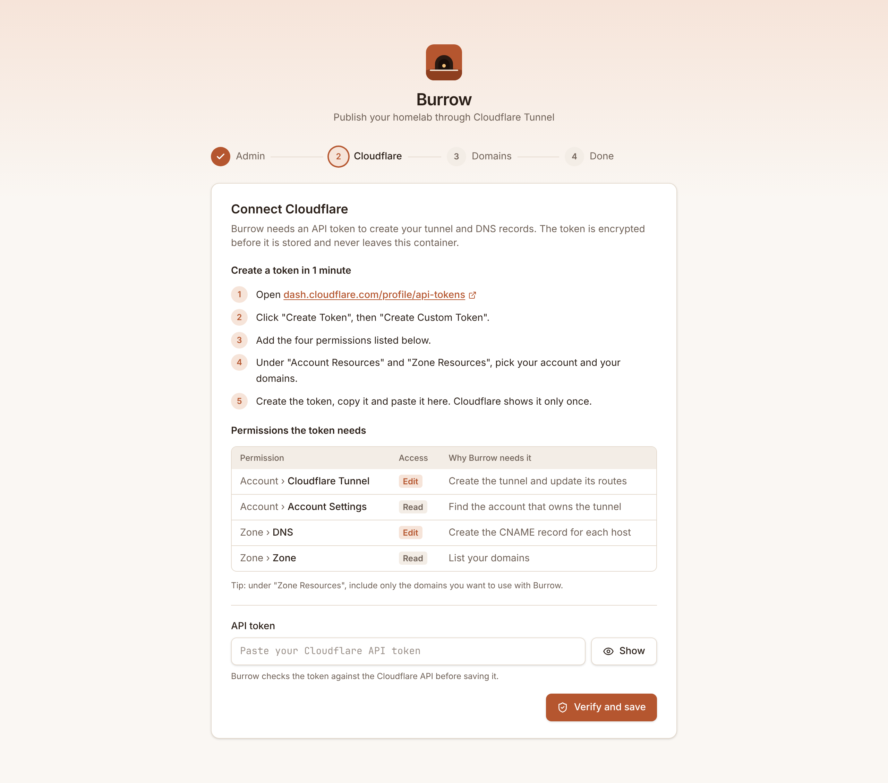
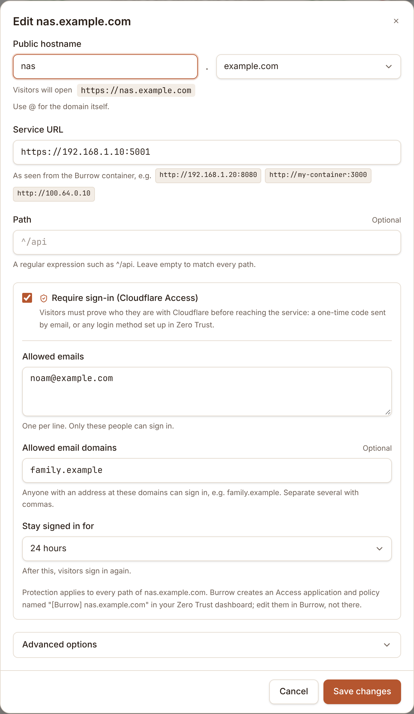

<p align="center">
  
</p>

<h1 align="center">Burrow</h1>

<p align="center">
  <strong>Publish your homelab services through Cloudflare Tunnel, from a simple web UI.</strong><br>
  Like Nginx Proxy Manager, but for Cloudflare Tunnel. No YAML, no Zero Trust dashboard, no open ports.
</p>

<p align="center">
  <a href="https://github.com/noamroger/burrow/actions/workflows/ci.yml"></a>
  <a href="https://github.com/noamroger/burrow/pkgs/container/burrow"></a>
  <a href="https://hub.docker.com/r/noamroger/burrow"></a>
  <a href="LICENSE"></a>
  <a href="https://buymeacoffee.com/noamroger"></a>
</p>

---

## What is Burrow?

[Cloudflare Tunnel](https://developers.cloudflare.com/cloudflare-one/connectors/cloudflare-tunnel/)
lets you put a service on the internet **without opening any port** on your
router: a small program, `cloudflared`, opens an outbound connection to
Cloudflare, and Cloudflare sends your visitors through it.

Setting it up by hand means creating a tunnel, writing ingress rules and
adding DNS records for every service. **Burrow does all of that for you.**

You run **one Docker container**. You open the web UI. For each service, you
type a name (`photos.example.com`) and an internal address
(`http://192.168.1.20:2342`). Burrow then:

1. adds the route to your tunnel,
2. creates the DNS record on Cloudflare,
3. keeps `cloudflared` running and shows you its logs,
4. checks that your service answers.

When you remove the service, Burrow removes the route and the DNS record.

## Features

- **One image, everything inside**: web UI, API, the official `cloudflared`
  binary and a SQLite database. Multi-arch (amd64 and arm64, so it runs on a
  Raspberry Pi).
- **Proxy hosts in a few clicks**: subdomain, domain, internal URL. Optional
  path, `noTLSVerify`, `httpHostHeader` and `originServerName` settings.
- **Private hosts with Zero Trust**: tick "Require sign-in" and list who may
  open a service (emails or whole email domains). Burrow creates the
  Cloudflare Access application and policy, so visitors sign in with a
  one-time code before they reach your service.
- **DNS handled for you**: Burrow creates the `CNAME` records and only ever
  touches records it created itself.
- **cloudflared supervision**: automatic start, restart with backoff, live
  logs in the browser.
- **Health at a glance**: tunnel status, connected Cloudflare data centers,
  and a reachability check for every service.
- **Several tunnels**: one per site (home, VPS…), each host picks its
  tunnel. Import a tunnel you already made in the Cloudflare dashboard,
  with its routes.
- **Drift alerts**: if someone edits a route, a DNS record or an Access app
  in the Cloudflare dashboard, Burrow shows what changed and lets you revert
  it or keep it (or repairs it automatically, if you prefer).
- **Backups**: scheduled copies of the database to a folder or to
  S3-compatible storage such as Cloudflare R2, with retention.
- **Templates**: Jellyfin, Plex, Home Assistant, Nextcloud, Proxmox,
  Vaultwarden, Portainer and more in one click, with the right origin
  options and the settings to change in the app itself.
- **Docker auto-discovery** (optional): add a `burrow.host=app.example.com`
  label to a container and it publishes itself, then disappears with the
  container.
- **Temporary hosts**: share a demo for 2 hours, Burrow removes the host,
  its DNS record and its Access app afterwards.
- **Maintenance mode**: one click serves a maintenance page (HTTP 503)
  instead of the service. The page is fully customizable: colours, logo,
  message, or your own HTML, with a live preview.
- **SSH, RDP and TCP**: publish non-HTTP services; SSH and VNC can even open
  in the browser behind Cloudflare Access.
- **Export, import and REST API**: move your configuration to another server
  as one JSON file, and script everything with API tokens and the built-in
  OpenAPI documentation at `/api/docs` (see [docs/api.md](docs/api.md)).
- **Secure by default**: argon2id passwords, encrypted API token, CSRF
  protection, login rate limiting, non-root container.

## Screenshots

| Proxy hosts                                     | Add a host                                    |
| ----------------------------------------------- | --------------------------------------------- |
|  |  |

| Tunnel and live logs                                        | First-run setup                                  |
| ----------------------------------------------------------- | ------------------------------------------------ |
|  |  |

| Private host (Cloudflare Access)                               |
| -------------------------------------------------------------- |
|  |

## Quick start (2 minutes)

**You need:** a machine with Docker, and a domain that uses Cloudflare DNS.

**1. Create `docker-compose.yml`:**

```yaml
services:
  burrow:
    image: ghcr.io/noamroger/burrow:latest
    container_name: burrow
    restart: unless-stopped
    ports:
      - '8080:8080' # the admin UI: keep it on your LAN, do not expose it publicly
    volumes:
      - ./data:/data
```

**2. Start it:**

```bash
docker compose up -d
```

**3. Open `http://<your-server-ip>:8080`** and follow the setup:

1. create your admin account,
2. paste a Cloudflare API token (see below),
3. choose the domains Burrow may use,
4. add your first proxy host.

That's it. Your service is online at `https://<name>.<your-domain>`, with
HTTPS handled by Cloudflare.

> The same image is also on Docker Hub. If you prefer it, use
> `image: noamroger/burrow:latest` instead.

## The Cloudflare API token

Burrow needs an API token to manage your tunnel and DNS records. Give it
**only** these permissions:

| Scope   | Permission        | Access | Why                                     |
| ------- | ----------------- | ------ | --------------------------------------- |
| Account | Cloudflare Tunnel | Edit   | Create the tunnel and update its routes |
| Account | Account Settings  | Read   | Find the account that owns the tunnel   |
| Zone    | DNS               | Edit   | Create the CNAME record for each host   |
| Zone    | Zone              | Read   | List your domains                       |

Optional, only for the features that need them:

| Scope   | Permission                | Access | Why                                                                                               |
| ------- | ------------------------- | ------ | ------------------------------------------------------------------------------------------------- |
| Account | Access: Apps and Policies | Edit   | Private hosts (see [Private hosts with Cloudflare Access](#private-hosts-with-cloudflare-access)) |
| Zone    | Analytics                 | Read   | Traffic statistics of each host (requests, bandwidth, countries), shown in **Monitoring**         |

**How to create it** (the same steps are shown in Burrow, on first launch and
in **Settings › Replace token**):

1. Open [dash.cloudflare.com/profile/api-tokens](https://dash.cloudflare.com/profile/api-tokens)
   (**My Profile › API Tokens**).
2. Click **Create Token** and start from a custom token, not a template.
   Name it, for example `Burrow`.
3. Add a first permission policy of type **Account** and select your
   account. In it, give **Cloudflare Tunnel**: Edit and
   **Account Settings**: Read (plus **Access: Apps and Policies**: Edit if
   you want private hosts).
4. Add a second policy of type **Zone** and select the domains Burrow may
   use. In it, give **DNS**: Edit and **Zone**: Read (plus **Analytics**:
   Read if you want traffic statistics).
5. Click **Continue to summary**, then **Create Token**, and paste the token
   into Burrow. Cloudflare shows it only once.

> **Can't find DNS or Zone?** They only exist in a policy of type **Zone**.
> The **DNS & Zones** category of an Account policy (DNS Settings, DNS
> Firewall, DNS Views...) does not have them, and Burrow needs none of its
> rows. If your dashboard is not in English, Read and Edit are translated
> (`Lu` and `Modifier` in French). On the older token form, each permission
> is a row of three dropdowns instead, for example `Zone` › `DNS` › `Edit`.

Burrow encrypts the token (AES-256-GCM) before saving it, never shows it
again, and never writes it to the logs.

## Private hosts with Cloudflare Access

Some services should not be open to the whole internet: a NAS, Grafana, an
admin panel. Edit the host, tick **Require sign-in (Cloudflare Access)** and
list the allowed emails (or a whole domain such as `family.example`).

Visitors then see a Cloudflare sign-in page first. With the default login
method they type their email and receive a one-time code; only the addresses
you listed get one. Your service never sees a request from anyone else.

**Before the first private host:**

1. Add the optional **Account › Access: Apps and Policies › Edit** permission
   to your token (Settings › Cloudflare token, then save it again so Burrow
   checks it).
2. If you never used Zero Trust on this account, open
   [Zero Trust](https://one.dash.cloudflare.com/) once and pick a team name.
   The free plan is enough (up to 50 users).

**What Burrow does:** for each protected hostname, it creates a reusable
Access policy ("allow" these emails and domains) and a self-hosted Access
application linked to it, both named `[Burrow] <hostname>`. The application
is created **before** the hostname is published, and removed only **after**
the route is gone, so a private host is never public, even for a second. If
the application cannot be created, the host is not published.

**Good to know:**

- Protection covers the whole hostname. Hosts that share a hostname with
  different paths share one application: their allowed lists are merged and
  the shortest session wins.
- Burrow never edits Access applications it did not create. If one already
  covers the hostname, Burrow refuses to protect it and tells you which one.
- Change the settings in Burrow, not in the Zero Trust dashboard: the next
  sync puts Burrow's version back.
- A new or changed protection takes about a minute to apply on Cloudflare.
  Until then, visitors may see "Unable to find your Access application":
  wait a moment and reload.

## Templates

In the host form, **Start from a template** fills in the service URL, a
suggested subdomain and the origin options an app needs behind a tunnel
(for example `noTLSVerify` for Proxmox, Portainer or Synology, which use a
self-signed certificate). It also lists what to change in the app itself,
such as Home Assistant's `trusted_proxies` or Nextcloud's `trusted_domains`.
WebSockets work through the tunnel without any option.

Templates are listed at `GET /api/templates`; their ids are also used by the
`burrow.template` Docker label.

## Docker auto-discovery

Off by default. Burrow can watch your containers and publish the ones that
carry a `burrow.host` label:

```yaml
services:
  jellyfin:
    image: jellyfin/jellyfin
    networks: [proxy] # a network Burrow is also on
    labels:
      burrow.host: jellyfin.example.com
      burrow.template: jellyfin # port 8096 and the right options
```

1. Give Burrow read-only access to Docker, either by mounting the socket
   (`/var/run/docker.sock:/var/run/docker.sock:ro`; Burrow joins the socket's
   group automatically) or, safer, through a
   [docker-socket-proxy](https://github.com/Tecnativa/docker-socket-proxy)
   with `CONTAINERS=1` and `DOCKER_HOST=tcp://socket-proxy:2375`.
2. Turn on **Settings › Docker discovery**. Burrow scans every 30 seconds
   and shows each labelled container with its status.

| Label                       | Meaning                                                                                |
| --------------------------- | -------------------------------------------------------------------------------------- |
| `burrow.host`               | Public hostname (required). Its domain must be enabled in Settings › Zones.            |
| `burrow.port`               | Port inside the container. Default: the template's port, the only exposed port, or 80. |
| `burrow.scheme`             | `http` (default), `https`, `ssh`, `rdp` or `tcp`                                       |
| `burrow.template`           | A template id (`jellyfin`, `proxmox`, `home-assistant`…): port, scheme and options     |
| `burrow.service`            | Full origin URL, overrides scheme, address and port                                    |
| `burrow.address`            | How Burrow reaches the container. Default: its name on a shared network, or its IP.    |
| `burrow.path`               | Path regex, e.g. `^/api`                                                               |
| `burrow.tunnel`             | Tunnel name (default tunnel otherwise)                                                 |
| `burrow.no-tls-verify`      | `true` for a self-signed certificate                                                   |
| `burrow.http-host-header`   | Host header sent to the service                                                        |
| `burrow.origin-server-name` | TLS server name expected from the service                                              |
| `burrow.access`             | Emails and email domains, comma separated: turns on Cloudflare Access                  |
| `burrow.access.session`     | Access session length: `30m`, `6h`, `12h`, `24h`, `168h` or `720h`                     |
| `burrow.access.browser`     | `ssh` or `vnc`: open the terminal or desktop in the browser (needs `burrow.access`)    |
| `burrow.enable`             | `false` to ignore the container                                                        |

Changing a label updates the host at the next scan; removing the container
(or the label) unpublishes it. A stopped container keeps its host. Hosts
from labels are marked **Docker** in the list and can only be changed
through the labels; Burrow never takes over a hostname you published by
hand. If Docker cannot be reached, nothing is removed.

## Temporary hosts

In the host form, **Remove automatically** publishes a host for 1 hour,
2 hours, 6 hours, a day or a week: handy to show a demo to someone. The
hosts list shows when it goes away. When the time is up, Burrow deletes the
host like a manual delete (tunnel route, DNS record, Access application).
Editing the host lets you extend the time or keep it for good. Temporary
hosts are not included in configuration exports.

## Maintenance mode

The **Maintenance** button (cup icon) on a host serves a maintenance page
instead of the service, with HTTP status 503 and a `Retry-After` header so
search engines do not drop your page. Turn it off and the route goes back to
the service. Cloudflare Access stays in place the whole time.

The page is yours to design in **Settings › Maintenance page**: title,
message, colours and logo (URL or upload), or switch to **Custom HTML** and
paste a complete page. `{{hostname}}` and `{{until}}` (the expected end you
can set when turning maintenance on) are replaced in both modes, and a live
preview shows the result. Any host can also have its own page.

How it works: the host's tunnel route is pointed at a small server inside
the Burrow container (`127.0.0.1:8081`), separate from the admin UI, that
only serves these pages. If a tunnel's connector runs on another machine,
set `MAINTENANCE_LISTEN=0.0.0.0`, publish port 8081 and set
`MAINTENANCE_ORIGIN` to an address that machine can reach.

## SSH, RDP and other TCP services

Use `ssh://`, `rdp://`, `tcp://` or `smb://` service URLs (or the SSH, VNC
and RDP templates). Browsers cannot open these directly, so the host form
shows the command people run on their computer with
[cloudflared](https://developers.cloudflare.com/cloudflare-one/networks/connectors/cloudflare-tunnel/downloads/)
installed, for example:

```sh
ssh -o ProxyCommand="cloudflared access ssh --hostname %h" user@ssh.example.com
cloudflared access rdp --hostname rdp.example.com --url rdp://localhost:3389
```

**In the browser:** protect an SSH or VNC host with Cloudflare Access and
choose **Open in the browser › SSH terminal** (or **VNC desktop**, with a
`tcp://` service). After signing in, visitors get a terminal or a desktop at
`https://<hostname>`, no client needed. For SSH, the part of the email before
the `@` must be a user on the server.

Cloudflare can also render RDP in the browser, but that needs a private
network route and an Access "target" rather than a public route, which
Burrow does not set up yet: RDP hosts use `cloudflared access rdp`.

## Configuration

Everything is configured from the UI. These environment variables are all
optional:

| Variable                       | Default                       | Description                                                                                                                                                               |
| ------------------------------ | ----------------------------- | ------------------------------------------------------------------------------------------------------------------------------------------------------------------------- |
| `PORT`                         | `8080`                        | Port of the web UI                                                                                                                                                        |
| `BURROW_SECRET`                | _(generated)_                 | Key used to encrypt the API token (32+ characters). If not set, a random key is created in `/data/.secret`. Set it if you want to back up `/data` without the key inside. |
| `TZ`                           | `UTC`                         | Time zone used in logs                                                                                                                                                    |
| `LOG_LEVEL`                    | `info`                        | `debug`, `info`, `warn` or `error`                                                                                                                                        |
| `TRUST_PROXY`                  | `false`                       | Set to `true` if you put the UI behind another reverse proxy                                                                                                              |
| `BURROW_SECURE_COOKIES`        | `auto`                        | `true` forces `Secure` cookies (UI served over HTTPS)                                                                                                                     |
| `BACKUP_DIR`                   | `/data/backups`               | Where scheduled backups go when the destination is "Folder on the server"                                                                                                 |
| `RECONCILE_INTERVAL_SECONDS`   | `300`                         | How often Burrow checks for changes made in the Cloudflare dashboard (`0`: only at startup and on demand)                                                                 |
| `DOCKER_HOST`                  | `unix:///var/run/docker.sock` | Docker API used by auto-discovery (a socket path or `tcp://host:2375`)                                                                                                    |
| `DOCKER_SCAN_INTERVAL_SECONDS` | `30`                          | How often Docker discovery scans the containers                                                                                                                           |
| `MAINTENANCE_PORT`             | `8081`                        | Port of the maintenance page server (`0` turns it off)                                                                                                                    |
| `MAINTENANCE_LISTEN`           | `127.0.0.1`                   | Address it listens on. Use `0.0.0.0` only if a tunnel connector runs on another machine.                                                                                  |
| `MAINTENANCE_ORIGIN`           | `http://127.0.0.1:8081`       | URL cloudflared uses to reach it                                                                                                                                          |
| `PUID` / `PGID`                | `1000`                        | User and group ids Burrow runs as. On start, Burrow makes `/data` belong to them (you never need to `chown` it).                                                          |

All data lives in `/data` (SQLite database and secret key). Back up this
folder, or turn on scheduled backups in **Settings › Backups**: Burrow then
copies its database every few hours to `/data/backups` or to S3-compatible
storage (Cloudflare R2, AWS S3, MinIO…) and keeps the last N copies.

To restore a backup: stop Burrow, unzip it (`gunzip burrow-….db.gz`), put it
in `/data` as `burrow.db`, and start Burrow. The Cloudflare token inside is
encrypted with the instance key, so keep `/data/.secret` (or your
`BURROW_SECRET`) with your backups.

<details>
<summary><strong>Permissions on <code>/data</code>, <code>user:</code> and hardened setups</strong></summary>

The container starts as root only long enough to make `/data` belong to
`PUID:PGID` (1000:1000 by default), then switches to that user. Node and
`cloudflared` never run as root. The ownership is only changed when it is
wrong (for example the first time, when Docker creates `./data` as root), so
normal restarts do not touch your files.

- **Hardened setup with `cap_drop: [ALL]`:** also add
  `cap_add: [CHOWN, SETUID, SETGID]`, as in the example
  [`docker-compose.yml`](docker-compose.yml). These capabilities are only used
  at startup; Burrow itself runs with none.
- **Prefer to start directly as a non-root user** (`user: "1000:1000"`)?
  That works too, but then Burrow cannot fix the owner: create the folder
  yourself with `mkdir data && sudo chown 1000:1000 data`.
- **NFS share with root squashing:** the owner cannot be changed from the
  container. Set `PUID`/`PGID` to the owner of the share, or `chown` it on
  the server.

</details>

## Networking FAQ

The important rule: **`cloudflared` runs inside the Burrow container**, so
the service address you type must be reachable **from that container**. Use
the **Check now** button on a host to test it.

<details>
<summary><strong>My service is another Docker container on the same machine</strong></summary>

Put Burrow and the service on the same Docker network and use the
**container name** as the host:

```yaml
services:
  burrow:
    image: ghcr.io/noamroger/burrow:latest
    networks: [proxy]
    # ...
  whoami:
    image: traefik/whoami
    networks: [proxy]

networks:
  proxy:
    name: proxy
```

Service URL in Burrow: `http://whoami:80`. If the service is in another
compose project, create the network once with `docker network create proxy`
and declare it as `external: true` in both files.

</details>

<details>
<summary><strong>My service is on another machine in my LAN</strong></summary>

Use its LAN IP, for example `http://192.168.1.20:8080`. Docker containers
can reach the LAN by default.

</details>

<details>
<summary><strong>My service runs directly on the Docker host (not in a container)</strong></summary>

Two options:

- Add `extra_hosts: ["host.docker.internal:host-gateway"]` to the Burrow
  service and use `http://host.docker.internal:<port>`. The service must
  listen on `0.0.0.0` or on the Docker bridge address, not only on `127.0.0.1`.
- Or run Burrow with `network_mode: host` and use `http://127.0.0.1:<port>`.
  The UI is then on port 8080 of the host directly (remove `ports:`).

</details>

<details>
<summary><strong>My service is on my Tailscale network</strong></summary>

The container must be able to reach the Tailscale IPs (`100.x.y.z`). The
simplest way is `network_mode: host` on a machine where Tailscale is
installed, then use `http://100.x.y.z:<port>`. Another way is to run a
Tailscale sidecar container and use `network_mode: service:tailscale`.

</details>

<details>
<summary><strong>My service uses HTTPS with a self-signed certificate</strong></summary>

Use `https://...` as the service URL and enable **No TLS Verify** in the
advanced options. If the certificate is valid for another name, set
**Origin Server Name** to that name instead.

</details>

<details>
<summary><strong>My service only answers for a specific Host header</strong></summary>

Set **HTTP Host Header** in the advanced options (for example
`app.local`).

</details>

<details>
<summary><strong>I get "DNS conflict" when I add a host</strong></summary>

A DNS record with that name already exists and Burrow did not create it.
Burrow never overwrites your records. Delete or rename the record in the
Cloudflare dashboard, then click **Sync now**.

</details>

<details>
<summary><strong>Should I expose the Burrow UI through the tunnel?</strong></summary>

It is safer to keep it on your LAN or behind a VPN like Tailscale. If you
publish it, tick **Require sign-in (Cloudflare Access)** on that host and
allow only your own email.

</details>

## How it works

```
 Browser ─▶ Burrow UI/API ─▶ Cloudflare API (tunnel routes + DNS records)
                │
                └─ supervises ─▶ cloudflared ═══ outbound tunnel ═══▶ Cloudflare edge ◀─ visitors
                                     │
                                     └─▶ your services (Docker network, LAN, Tailscale)
```

Burrow creates a **remotely managed** tunnel: the routes are stored on
Cloudflare, so changes apply instantly without restarting `cloudflared`. Your
choices are saved in SQLite, and a background sync makes sure Cloudflare
matches them. Burrow never removes routes or DNS records it did not create.

Read more in [docs/architecture.md](docs/architecture.md) and the
[architecture decision records](docs/adr/).

## Roadmap

**v0.1 (MVP)**: admin account, Cloudflare token and zones, proxy hosts with
synced routes and DNS, cloudflared supervision with live logs, health
checks, multi-arch image.

**v0.2**: private hosts protected by Cloudflare Access (allowed emails and
email domains, session length).

**v0.3**: several tunnels and tunnel import, configuration export and
import, REST API with OpenAPI docs and API tokens, drift alerts, scheduled
backups (folder or S3/R2).

**v0.4**: service templates, Docker auto-discovery with labels, temporary
hosts, maintenance mode with a customizable page, SSH/RDP/TCP hosts with
browser-rendered SSH and VNC.

**Next:**

- [x] Docker auto-discovery with labels (`burrow.host=app.example.com`,
      `burrow.port=3000`), read-only socket, optional
- [x] Templates, temporary hosts, maintenance mode
- [x] SSH, RDP and TCP hosts, browser-rendered SSH and VNC
- [ ] Browser-rendered RDP (private network route and Access target)
- [x] Cloudflare Access applications and policies ("only my email can open this")
- [ ] More Access rules (identity provider groups, countries, service tokens)
- [x] Several tunnels, import an existing tunnel
- [x] Config export and import
- [x] Documented REST API (OpenAPI)
- [x] Drift alerts (changes made in the Cloudflare dashboard)
- [x] Scheduled backups (folder or S3/R2)
- [ ] Notifications (Discord, ntfy, webhook)
- [ ] French translation

Ideas and votes are welcome in the
[issues](https://github.com/noamroger/burrow/issues).

## Contributing

Contributions are very welcome, from typo fixes to new features. The project
uses TypeScript everywhere (Fastify on the server, React on the web) and you
**do not need a Cloudflare account** to work on it: a mock Cloudflare API and
a fake `cloudflared` are included.

```bash
git clone https://github.com/noamroger/burrow.git
cd burrow
corepack enable
pnpm install
pnpm dev:mock   # fake Cloudflare API + fake cloudflared + server + web UI
```

Then open http://localhost:5173. Any token of 20+ characters is accepted by
the mock.

Read [CONTRIBUTING.md](CONTRIBUTING.md) for the full guide (project layout,
tests, commit style, how to add a database migration). Please also read our
[Code of Conduct](CODE_OF_CONDUCT.md). To report a security issue, see
[SECURITY.md](SECURITY.md).

## Support the project

Burrow is free and open source. If it saves you time, you can
[buy me a coffee](https://buymeacoffee.com/noamroger) ☕. Starring the repo
and reporting bugs help a lot too.

## Acknowledgements

- [Nginx Proxy Manager](https://nginxproxymanager.com/), for showing how
  pleasant a reverse proxy UI can be.
- [Cloudflare](https://github.com/cloudflare/cloudflared) for `cloudflared`.

Burrow is an independent project and is not affiliated with Cloudflare.

## License

[MIT](LICENSE) © Noam
